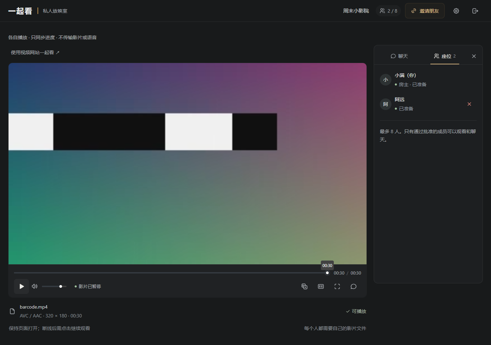

# Interlude / 幕间

Watch local videos with friends. The host chooses a file, approves guests and controls playback. Everyone can chat while watching.

[Try it](https://interlude-eoqk.onrender.com) · [Getting started](docs/GETTING_STARTED.en.md) · [Self-hosting](docs/FREE_HOSTING.md) · [中文](README.md)



## Features

- Private rooms for up to eight people, with invitations and host approval.
- Shared play, pause and seek controls; guests can request a pause.
- Text and opt-in voice chat, with separate movie and voice volumes.
- SRT/VTT subtitles with size and timing adjustments.
- Direct WebRTC for small rooms, with LiveKit fallback for failed connections or larger groups.
- Browser interface, responsive viewer layout and self-hosting support.

The original file is not uploaded for storage. The host must keep the tab open and reselect the file after refreshing. Use desktop Chrome or Edge to host local video.

## Watch with friends

Create a room, select a video and copy an invitation. When someone requests entry, use the request notice to open the approval list. Start screening after approval; guests click Start watching. Microphones stay off until enabled. Friends do not need hosting accounts.

The demo uses free hosting and may take around a minute to wake up or pause when quota runs out. For regular use, [deploy your own instance](docs/FREE_HOSTING.md) with your own service credentials and quota.

## Run locally

Install Git and Node.js 24+, then:

```sh
git clone https://github.com/askandtell/interlude.git
cd interlude
npm ci
node scripts/setup-dev.mjs
```

Run `npm run dev` and `npm run ui` in separate terminals. Open **http://127.0.0.1:15173** exactly. Local small-room P2P works without a cloud account. LiveKit enables relay fallback; see [deployment](docs/DEPLOYMENT.md). Without Redis, development rooms are lost on restart.

## Deploy and develop

The repository includes Docker Compose and a Free Render Blueprint. A provider subdomain avoids buying a domain or VPS. Keep LiveKit secrets in server environment variables. Forking the source does not include the maintainer's cloud resources.

- [User and setup guide](docs/GETTING_STARTED.en.md)
- [Deployment](docs/DEPLOYMENT.md) and [free hosting limits](docs/FREE_HOSTING.md)
- [Direct and relay behavior](docs/HYBRID_MEDIA.md)
- [Architecture](docs/ARCHITECTURE.md), [security](docs/SECURITY.md) and [test results](docs/TEST_REPORT.md)

Run `npm run check` and `npm run test:e2e`. Generate media fixtures with `npm run test:media` after installing FFmpeg. Set `MEDIA_E2E=1` with a running local LiveKit to include relay tests. Public tests use `PUBLIC_E2E_URL` and `npm run test:public`; they create temporary rooms and consume some media quota.

## Limitations

This is an early release. Desktop browsers and the public HTTPS instance have been tested with real direct and cloud-relayed video/audio. Separate-ISP networks, physical phones, TURN-only conditions and a two-hour soak still need testing. Viewers cannot seek independently within the shared live stream.

The [official-site sync extension](docs/WEBSITE_WATCH.md) is experimental and requires each viewer's own access rights. Jellyfin, native clients and personal subtitle tracks are not implemented.

## License

Derived from Howard Chung's [WatchParty](https://github.com/howardchung/watchparty), under MIT. Upstream history, license and attribution are retained, including the browser transcoding module. See [LICENSE](LICENSE) and [third-party notices](THIRD_PARTY_NOTICES.md).