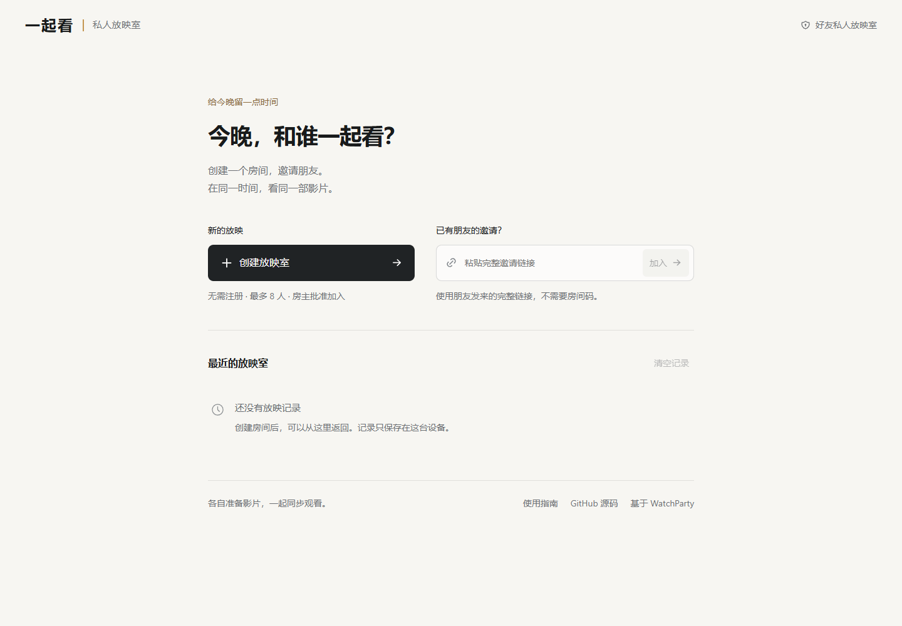

# 幕间 · Interlude

**和在意的人，看同一场电影。**

浏览器优先的好友私人放映室。房主选择本地影片，朋友通过私密邀请申请入座；文字、语音与电影分轨传输，影片不作为文件上传保存。

**第一次来？阅读[用户入门与自行部署](docs/GETTING_STARTED.md)。** 加入朋友的房间无需云服务账号；自行部署需使用自己的服务配置。公开源码不包含维护者的免费额度或密钥。

**[打开在线体验](https://interlude-eoqk.onrender.com)** · [使用与自行部署](docs/GETTING_STARTED.md) · [English](README.en.md)

> v0.1 已通过公开 HTTPS 实例的双浏览器直连、云端转发音画测试。免费体验站可能休眠或耗尽额度；跨运营商、TURN-only、真实手机及两小时连续播放仍待验收。请阅读 [安全说明](docs/SECURITY.md) 和 [验证报告](docs/TEST_REPORT.md)。




## 已实现

- 2—8 人房间；免注册昵称、私密邀请、房主审批、移除成员、转交管理、结束房间。
- 真实本地影片分享；1—3 人优先 P2P，直连失败或 4 人起自动使用 LiveKit 转发，保留影片并关闭麦克风。详见[混合媒体说明](docs/HYBRID_MEDIA.md)。
- 主持播放、暂停、跳转；UUID 去重、版本/媒体代次校验、重连快照。
- 文字聊天、暂停请求、按需开启的语音、独立电影/朋友音量。
- 文件内容预检；可选 WatchParty/Mediabunny 本地兼容转换；有界 SRT/VTT 纯文本字幕合成。
- 浅色入口与深色放映室：创建／邀请／本机记录、统一播放控制、移动端聊天抽屉，无装饰图片与 3D 依赖。
- 候选文件预检，失败／取消保留原影片；刷新后重新选片并确认续播，不自动恢复文件权限。
- 共享字幕字号、时间偏移、自动换行；房主预览就是实际合成画面。
- 主动麦克风检测、输入电平、测试音和能力受限的设备选择；关闭设置释放临时音轨。
- 签名会话、CSRF/Origin 校验、媒体最小权限、踢人后媒体代次轮换、签名媒体通知和发布轨检查。
- Redis TTL 存储；仅开发环境可使用内存存储；Docker Compose、CI、安全与部署文档。

## 快速开始

需要 Node.js 24+、npm。本机 P2P 试用不需要云服务账号；测试转发时另外启动 Docker 或原生 LiveKit Server。

```sh
npm ci
node scripts/setup-dev.mjs
# 可选：npm run infra 启动本机转发服务
```

再打开两个终端：

```sh
npm run dev
npm run ui
```

打开 **http://127.0.0.1:15173**。必须使用这个 Origin；不要混用 localhost。本机开发的 Redis 可选，Compose Redis 默认不对宿主机开放；不配置 REDIS_URL 时使用开发内存存储。完整容器版使用 `docker compose up --build`，访问 **http://localhost:18080**。

如果没有 Docker，可运行 `livekit-server --config deploy/livekit.local.yaml`。生成的本地配置只适用于本机，不能直接用于公网。

## 一起看

1. 房主创建房间，用桌面 Chrome / Edge 选择本地影片。
2. 点击「邀请朋友」复制链接；每次复制生成新邀请，先前的邀请随即失效。
3. 朋友填写昵称，房主在「座位」页批准。
4. 房主点击「开始放映」，朋友点击「开始观看」。麦克风默认关闭。
5. 换片或刷新后需重新确认放映；本地文件不会自动转移给新房主。

观看端接收实时流，不能独立拖动电影时间线。画质会受设备与网络影响；不保证所有 MKV/HEVC/音轨都可解码。具体版本支持以真实浏览器测试为准。

字幕在播放器的「字幕设置」中载入；正时间偏移表示延后。续播提示仅使用本机标签页的文件元数据匹配，并要求确认，不证明两个文件内容相同。麦克风检测不会加入媒体房间；播放输出选择仅在浏览器支持且设备列表可读取时出现。

## 检查与测试

```sh
npm run check
npm run test:e2e
npm run test:media
```

运行实际媒体端到端测试：启动本地 LiveKit、生成测试片后设置 `MEDIA_E2E=1` 并运行 `npm run test:e2e`。PowerShell 设置方式：`$env:MEDIA_E2E='1'`。测试浏览器需先执行 `npx playwright install chromium`，也可通过 PLAYWRIGHT_EXECUTABLE_PATH 使用已有浏览器。

## 开源来源

主要派生自 [WatchParty](https://github.com/howardchung/watchparty)，保留完整上游历史和 MIT LICENSE；基线为 `2d366c1006b7b86228bcd7bb6debc111d857f51e`。保留并复用其本地转换模块，移除支付、云浏览器等功能，重新设计私密房间权限与界面。详见 [第三方声明](THIRD_PARTY_NOTICES.md)。

[架构](docs/ARCHITECTURE.md) · [部署](docs/DEPLOYMENT.md) · [安全](docs/SECURITY.md) · [English](README.en.md)

Jellyfin、原生电脑/手机客户端、个人独立字幕和端到端加密属于后续阶段，目前未实现。源码已公开；公网实例的验证范围见验证报告。

## 视频网站一起看（实验性）

房间中可粘贴哔哩哔哩、优酷、爱奇艺、腾讯视频的官方播放页。每个人各自在官网登录观看，幕间同步时间和操作；不会把会员视频转发给没有权限的人。无扩展时手动对齐，Chrome／Edge 可加载仓库内同步扩展。四站真实账号适配仍待验收。安装步骤、权限、广告与兼容边界见 [视频网站使用说明](docs/WEBSITE_WATCH.md)。

### 本地影片可预览但无法放映

若提示媒体服务不可用，先启动独立 LiveKit：`npm run media:local`（保留此终端运行）。Windows 会优先使用 `.cache/livekit/livekit-server.exe`；其他环境使用 PATH 中的 livekit-server，也可用 LIVEKIT_BIN 指定。不要在已经运行媒体服务时重复启动。页面会在故障期间每 5 秒重新检查，恢复后手动重试播放，无需重新选片。此命令不下载程序、不修改密钥，也不启动 Redis 或控制服务。

### 内置浏览器的 WebRTC 配置错误

若浏览器拒绝 setConfiguration，幕间会通过实际能力检测选用 LiveKit 双连接初始化；正常浏览器保持默认模式。探针不会读取账号或申请麦克风。无法建立连接时保留影片并提供中文重试提示。实际 Codex 内置浏览器的初次放映及重新播放已验证；该环境的断网重连仍待验收。

## 免费固定网址部署

不购买域名和服务器的个人方案：Render 免费应用＋免费 Key Value，搭配 LiveKit Cloud Build 免费媒体额度，使用平台提供的 HTTPS 二级域名。`render.yaml` 已锁定 Free 规格，来源和限制见 [免费部署说明](docs/FREE_HOSTING.md)。实际网址及公网音画验收另行报告，不能把部署文件当成上线成功。
